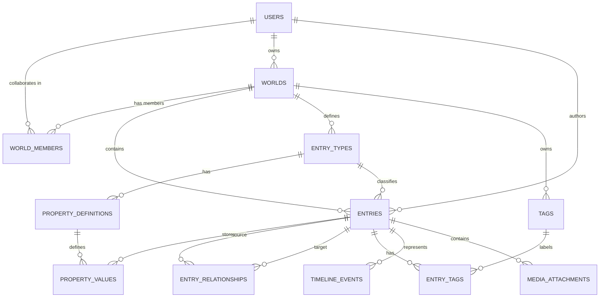

# Lorekeeper — Project Specification & Architecture Blueprint

> **Codename**: Lorekeeper  
> **Repository / Path**: `D:\Wengdev\Lorebook`  
> **Status**: Planning & UI Prototyping Complete  
> **Test Realm**: *Canaan*  

---

## 1. Project Overview & Vision

**Lorekeeper** is a private, local-first worldbuilding encyclopedia and writer's workspace. It bridges the gap between structured relational data (like character profiles, kingdom lineages, and timelines) and flexible creative writing (prose, alternate histories, and draft brainstorming).

### Core Philosophy
- **Structured Lore, Not Loose Notes**: Lore entries are not just giant text documents; they contain structured attributes (species, titles, affiliations, relics) alongside a rich article body.
- **Canon Protection**: Strict division between `Canon`, `Draft`, and `Archived` lore. Unresolved contradictions and alternative legends can be tracked explicitly without contaminating established canon.
- **Interconnected Web**: Directed, typed relationships between entities (characters, artifacts, factions, locations) with automatic backlink indexing and chronological event timelines.
- **Data Sovereignty**: Local machine storage with complete manual export/import capabilities. Your creative work is never trapped behind proprietary cloud services.

---

## 2. Visual Direction & Design System

The application aesthetic is **"The Field Archivist's Grimoire"** — a fusion of tactile dark paper manuscripts and **Zerostudios** mechanical precision.

### 2.1 Aesthetic Principles
- **Base Surface**: Deep charcoal paper (`#151419`) with subtle dual-angle fiber weave textures, avoiding sterile digital blacks.
- **Mechanical Precision (Zerostudios Influence)**: 
  - Zero-blur ink offset drop shadows (`4px 4px 0 #08070A`, `2px 2px 0 #08070A`).
  - Solid `1.5px` to `2px` ink borders on cards, inputs, and badges.
  - Flush card `.title-bar` dossier strips with technical registry codes (`DOSSIER // CAN-014`).
- **Restrained Accents**: Antique gold (`#C5A869`), pale ivory (`#ECE7DD`), aged copper (`#BA7A55`), and crimson wax seal badges (`#A53232`). Neon and modern saturated purples are deliberately avoided in favor of classical illuminated manuscript tones.
- **Typography Hierarchy**:
  - **Ancient Headings & Titles**: `Cormorant Garamond` (classic gravitas, tracking, high-contrast serif).
  - **Monumental & Inscription Details**: `Cinzel` (carved stone styling for seals, stanzas, and dates).
  - **Prose & Long-Form Reading**: `Newsreader` (effortless literary reading with drop-caps and pull-quotes).
  - **Archival Telemetry & Controls**: `Space Mono` (attributes, dates, word counts, filter chips, keyboard shortcuts).

---

## 3. Technology Stack & Boundaries

The technical boundary is kept intentionally lean, robust, and local-first to ensure maximum stability and offline reliability.

### 3.1 Core Stack
| Layer | Technology | Rationale |
| :--- | :--- | :--- |
| **Backend Framework** | **PHP + CodeIgniter 3 (CI3)** | Lightweight MVC architecture, rapid local prototyping, zero external runtime bloat. |
| **Database** | **MySQL / MariaDB (InnoDB)** | Relational integrity, foreign keys, transaction safety for multi-table lore operations. |
| **Local Runtime** | **XAMPP / Apache on `127.0.0.1`** | Direct local hosting in your browser without cloud or node server dependencies. |
| **Styling & UI** | **Tailwind CSS** | Utility-first styling compiled to static CSS, matching Zerostudios component ergonomics. |
| **Frontend Scripting** | **Vanilla JavaScript** | Minimal footprint for modal dialogs, tab switching, autosave debouncing, and search overlays. |
| **Canonical Content Storage** | **Markdown (`LONGTEXT`)** | Safe, portable format for article bodies; converted to/from WYSIWYG during authoring. |

### 3.2 Technical Boundaries & Non-Goals for MVP
- **Local-Only**: No mandatory internet connection, cloud syncing, or external API dependencies.
- **Single-User Scope (Initial)**: No multi-user authentication or role permissions in the MVP phase (isolated by local session).
- **Static Map Editor**: No heavy canvas GIS/map engines in initial releases (simple image pins/links instead).
- **No AI Dependencies**: No automated AI lore generators or external LLM scrapers touching the database.
- **Separation of Media**: Image assets reside in a dedicated local directory (`storage/media/`), referenced via database records, never stored as raw BLOBs.

---

## 4. Application Architecture & Data Model

### 4.1 Database Entity Relationship (ERD)



### 4.2 Core Tables Overview
1. **`users`**: Account registry (`id`, `public_id`, `username`, `email`, `password_hash`, `display_name`, `avatar`, `role`, `is_active`).
2. **`world_members`**: Collaboration and world permissions (`world_id`, `user_id`, `role`).
3. **`worlds`**: Multi-universe support (`id`, `public_id`, `owner_id`, `name`, `slug`, `visibility`, `description`).
4. **`entry_types`**: Configurable templates (`Character`, `Location`, `Faction`, `Artifact`, `Historical Event`, `Magic System`).
5. **`entries`**: Core entity record (`id`, `public_id`, `world_id`, `entry_type_id`, `title`, `slug`, `summary`, `content_markdown`, `status`, `is_archived`, `created_by`, `updated_by`).
6. **`property_definitions` & `property_values`**: EAV-style typed custom fields (`value_text`, `value_number`, `value_boolean`, `value_date`, `referenced_entry_id`) preventing frequent table alter migrations.
7. **`entry_relationships`**: Directed typed edges (`source_id`, `target_id`, `relationship_type`, `description`).
8. **`timeline_events`**: Historical chronology supporting in-universe fictional eras and custom precision sort keys.
9. **`tags` & `entry_tags`**: Cross-cutting classification labels.
10. **`media_attachments`**: Uploaded portrait and document metadata.

---

## 5. CodeIgniter 3 Project Layout

```text
lorekeeper/
├── application/
│   ├── config/             # database.php, routes.php, migration.php
│   ├── controllers/
│   │   ├── Dashboard.php       # World overview & recent changes
│   │   ├── Worlds.php          # World creation & switching
│   │   ├── Entries.php         # Entry CRUD & viewer
│   │   ├── Entry_types.php     # Custom property & template builder
│   │   ├── Relationships.php   # Connection manager & backlink explorer
│   │   ├── Timeline.php        # Chronological era explorer
│   │   ├── Tags.php            # Categorical cross-cutting tags
│   │   ├── Archive.php         # Soft-archived lore management
│   │   ├── Import_export.php   # ZIP / JSON backup & restore
│   │   └── Settings.php        # Theme & local storage settings
│   ├── models/             # World_model, Entry_model, Property_model, etc.
│   ├── services/           # Lore_export_service, Entry_relationship_service
│   ├── libraries/          # Markdown_parser.php, Upload_manager.php
│   ├── migrations/         # 001_create_worlds.php through 008_create_media.php
│   └── views/
│       ├── layouts/        # app.php, sidebar.php, topbar.php
│       ├── entries/        # show.php, form.php, index.php
│       └── ...             # Component views
├── assets/
│   ├── css/                # Compiled Tailwind stylesheet
│   ├── js/                 # app.js, entry-editor.js, relations.js
│   └── vendor/             # Local offline vendor scripts
├── storage/
│   ├── media/              # Local uploaded portraits & relics
│   └── exports/            # Generated backup archives
├── index.php
└── README.md
```

---

## 6. Development Milestones & Roadmap

### Milestone 1: Project Foundation & World Scoping (Completed)
- [x] UI Prototype and Design Language established (`mockup-zerostudios.html`).
- [x] Initialize clean CodeIgniter 3 structure in `c:\xampp\htdocs\Lorekeeper`.
- [x] Implement database migrations (`001` through `009`) including `users`, `world_members`, `worlds`, `entry_types`, `entries`, `properties`, `relationships`, `tags`, `timeline`, and `media`.
- [x] Build modular layout shell (`head`, `topbar`, `header`, `footer`, `layouts/main`) and auto-seeding `Dashboard`.

### Milestone 2: Encyclopedia CRUD & Custom Attributes (In Progress)
- [x] Build entry creation (`entries/create`) and detail dossier view (`entries/view`).
- [ ] Build Encyclopedia Browser (`entries/index`) with search and multi-attribute filters (Type, Status, Tag).
- [ ] Build entry editing (`entries/edit`), updating, and soft-archiving.
- [ ] Implement schema-driven template & property manager UI (add/edit custom fields per entry type).

### Milestone 3: Dual Editor & Media Vault
- [ ] Integrate local WYSIWYG editor with lossless Markdown two-way conversion.
- [ ] Secure local image upload system with hashed filenames and metadata tracking.
- [ ] Internal wiki link resolution (`lore://entry/<uuid>`) with broken-reference detection.

### Milestone 4: Directed Relationships & Chronology
- [ ] Interactive relationship manager with inverse relationship labels.
- [ ] Automatic backlink index on every entry page.
- [ ] Chronological event timeline supporting custom fictional calendars.

### Milestone 5: Backup, Portability & Future Expansion
- [ ] Complete ZIP export package (`manifest.json`, structured data, Markdown, and media).
- [ ] Safe import wizard with pre-import validation and conflict detection.

---

## 7. Future Horizons (Post-MVP Plans)

1. **Interactive Node Graph Visualizer**: A canvas/SVG force-directed graph to explore character and faction connections visually.
2. **Interactive Cartography / Map Pins**: Upload world and regional maps, placing clickable pins that link directly to lore entries.
3. **Multi-User Collaboration & Web Deployment**:
   - Migration path to online hosting with user accounts, role-based access, and world sharing.
   - Designed from day one with stable UUID public keys and world scoping to make online transitions seamless.
4. **Offline Desktop Wrapper**: Option to package the local server into an Electron or Tauri desktop wrapper for double-click native app usage.
