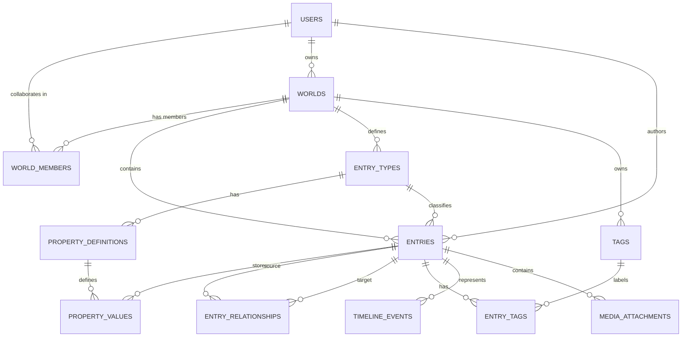

# Lorekeeper — Project Specification & Architecture Blueprint

> **Codename**: Lorekeeper  
> **Repository / Path**: `D:\Wengdev\Lorebook`  
> **Status**: Planning & UI Prototyping Complete  
> **Test Realm**: *Canaan*  

---

## 1. Project Overview & Vision

**Lorekeeper** is a private, local-first worldbuilding encyclopedia and writer's workspace. It bridges the gap between structured relational data (like character profiles, kingdom lineages, and timelines) and flexible creative writing (prose, alternate histories, and draft brainstorming).

### Core Philosophy
- **Structured Lore, Not Loose Notes**: Lore entries are not just giant text documents; they contain structured attributes (species, titles, affiliations, relics) alongside a rich article body.
- **Canon Protection**: Strict division between `Canon`, `Draft`, and `Archived` lore. Unresolved contradictions and alternative legends can be tracked explicitly without contaminating established canon.
- **Interconnected Web**: Directed, typed relationships between entities (characters, artifacts, factions, locations) with automatic backlink indexing and chronological event timelines.
- **Data Sovereignty**: Local machine storage with complete manual export/import capabilities. Your creative work is never trapped behind proprietary cloud services.

---

## 2. Visual Direction & Design System

The application aesthetic is **"The Field Archivist's Grimoire"** — a fusion of tactile dark paper manuscripts and **Zerostudios** mechanical precision.

### 2.1 Aesthetic Principles
- **Base Surface**: Deep charcoal paper (`#151419`) with subtle dual-angle fiber weave textures, avoiding sterile digital blacks.
- **Mechanical Precision (Zerostudios Influence)**: 
  - Zero-blur ink offset drop shadows (`4px 4px 0 #08070A`, `2px 2px 0 #08070A`).
  - Solid `1.5px` to `2px` ink borders on cards, inputs, and badges.
  - Flush card `.title-bar` dossier strips with technical registry codes (`DOSSIER // CAN-014`).
- **Restrained Accents**: Antique gold (`#C5A869`), pale ivory (`#ECE7DD`), aged copper (`#BA7A55`), and crimson wax seal badges (`#A53232`). Neon and modern saturated purples are deliberately avoided in favor of classical illuminated manuscript tones.
- **Typography Hierarchy**:
  - **Ancient Headings & Titles**: `Cormorant Garamond` (classic gravitas, tracking, high-contrast serif).
  - **Monumental & Inscription Details**: `Cinzel` (carved stone styling for seals, stanzas, and dates).
  - **Prose & Long-Form Reading**: `Newsreader` (effortless literary reading with drop-caps and pull-quotes).
  - **Archival Telemetry & Controls**: `Space Mono` (attributes, dates, word counts, filter chips, keyboard shortcuts).

---

## 3. Technology Stack & Boundaries

The technical boundary is kept intentionally lean, robust, and local-first to ensure maximum stability and offline reliability.

### 3.1 Core Stack
| Layer | Technology | Rationale |
| :--- | :--- | :--- |
| **Backend Framework** | **PHP + CodeIgniter 3 (CI3)** | Lightweight MVC architecture, rapid local prototyping, zero external runtime bloat. |
| **Database** | **MySQL / MariaDB (InnoDB)** | Relational integrity, foreign keys, transaction safety for multi-table lore operations. |
| **Local Runtime** | **XAMPP / Apache on `127.0.0.1`** | Direct local hosting in your browser without cloud or node server dependencies. |
| **Styling & UI** | **Tailwind CSS** | Utility-first styling compiled to static CSS, matching Zerostudios component ergonomics. |
| **Frontend Scripting** | **Vanilla JavaScript** | Minimal footprint for modal dialogs, tab switching, autosave debouncing, and search overlays. |
| **Canonical Content Storage** | **Markdown (`LONGTEXT`)** | Safe, portable format for article bodies; converted to/from WYSIWYG during authoring. |

### 3.2 Technical Boundaries & Non-Goals for MVP
- **Local-Only**: No mandatory internet connection, cloud syncing, or external API dependencies.
- **Single-User Scope (Initial)**: No multi-user authentication or role permissions in the MVP phase (isolated by local session).
- **Static Map Editor**: No heavy canvas GIS/map engines in initial releases (simple image pins/links instead).
- **No AI Dependencies**: No automated AI lore generators or external LLM scrapers touching the database.
- **Separation of Media**: Image assets reside in a dedicated local directory (`storage/media/`), referenced via database records, never stored as raw BLOBs.

---

## 4. Application Architecture & Data Model

### 4.1 Database Entity Relationship (ERD)



### 4.2 Core Tables Overview
1. **`users`**: Account registry (`id`, `public_id`, `username`, `email`, `password_hash`, `display_name`, `avatar`, `role`, `is_active`).
2. **`world_members`**: Collaboration and world permissions (`world_id`, `user_id`, `role`).
3. **`worlds`**: Multi-universe support (`id`, `public_id`, `owner_id`, `name`, `slug`, `visibility`, `description`).
4. **`entry_types`**: Configurable templates (`Persons & Clans`, `Realms & Seats`, `Sacred Orders`, `Bestiary & Relics`, `Chronicle & Eras`).
5. **`entries`**: Core entity record (`id`, `public_id`, `world_id`, `entry_type_id`, `title`, `slug`, `summary`, `content_markdown`, `status`, `is_archived`, `created_by`, `updated_by`).
6. **`property_definitions` & `property_values`**: EAV-style typed custom fields (`value_text`, `value_number`, `value_boolean`, `value_date`, `referenced_entry_id`) preventing frequent table alter migrations.
7. **`entry_relationships`**: Directed typed edges (`source_entry_id`, `target_entry_id`, `relationship_type`, `inverse_label`, `description`).
8. **`timeline_events`**: Historical chronology supporting in-universe fictional eras (`sort_year`, `end_year`, `is_approximate`).
9. **`tags` & `entry_tags`**: Cross-cutting classification labels.
10. **`media_attachments`**: Uploaded portrait and document metadata.
11. **`app_settings`**: Key-value settings table scoped per world for compendium annals, pillars, and telemetry.

### 4.3 The 5-Layer Entry Architecture
Every lore record is structured into five distinct, decoupled layers:
- **Layer 1: Identity** — Title, Slug, Entry Type, Summary, Status (`canon`, `draft`, `apocrypha`, `retconned`), Tags, and Author attribution (`Archivist Zerotsu`).
- **Layer 2: Structured Properties** — EAV custom fields dynamically rendered per `entry_type` (e.g. Origin Seat, Clan, Arcane Aspect, Current Ruler, Potency).
- **Layer 3: Article Body** — Full grimoire prose written in Markdown with illuminated drop-caps, ornamental dividers, quotes, and interactive live preview.
- **Layer 4: Dual Connection System** —
  - **A. Explicit Directed Relationships** (`entry_relationships`): Semantic, typed directional bonds with inverse labels (e.g. `bearer of` $\leftrightarrow$ `wielded by`).
  - **B. Internal Article Wiki Links** (`[[Wiki Links]]`): Inline prose references linking entities with automatic backlink indexing and unwritten redlink discovery (`[＋]`).
- **Layer 5: Management & Canon Protection** — Verification badges, audit timestamps, soft-delete archiving, and restoration protocol.

### 4.4 Directed Relationship Matrix Specification
The relationship matrix enables semantic graph exploration across entries:
- **Directional Predicates**: Forward predicate (`relationship_type`) paired with an inverse label (`inverse_label`).
- **Categorized Presets**:
  - *Allegiance & Rule*: `rules / commands` $\leftrightarrow$ `ruled by`, `sworn ally of` $\leftrightarrow$ `sworn ally of`, `vassal to` $\leftrightarrow$ `liege of`
  - *Blood & Lineage*: `parent of` $\leftrightarrow$ `child of`, `sibling of` $\leftrightarrow$ `sibling of`
  - *Conflict & Rivalry*: `nemesis of` $\leftrightarrow$ `nemesis of`, `rebelled against` $\leftrightarrow$ `betrayed by`
  - *Relics & Arcana*: `bearer of` $\leftrightarrow$ `wielded by`, `forged / created` $\leftrightarrow$ `crafted by`
  - *Geography*: `seat located in` $\leftrightarrow$ `seat of power for`
- **Contextual Annotation**: An optional `description` string detailing when or why the bond was forged.
- **Dossier Matrix UI**: Displayed as "Sworn Bonds & Ties" on `entries/view.php` with direct inline creation via quick-bind modal.

### 4.5 Expanded 9-Archetype Entry Taxonomy & Structured Bio Schemas
To support granular RPG-level character sheets, kingdoms, and magic systems, Lorekeeper expands into 9 distinct Entry Archetypes, each with dedicated Structured Property Definitions (`property_definitions`):

| Archetype / Type | Primary Focus | Dedicated Structured Attributes (`property_definitions`) |
| :--- | :--- | :--- |
| **1. Character** | Named individuals & historical figures | `species`, `age`, `occupation`, `origin_seat`, `clan`, `weapon`, `aspect`, `abilities` |
| **2. Creature / Species** | Flora, fauna, races, and legendary monsters | `classification`, `average_lifespan`, `habitat`, `diet`, `innate_traits`, `threat_level` |
| **3. Location** | Natural geography, rivers, ruins, and sites | `region`, `coordinates_terrain`, `climate`, `controlling_faction`, `points_of_interest` |
| **4. Nation / Political State** | Sovereign kingdoms, empires, and duchies | `government_type`, `current_ruler`, `capital_seat`, `population`, `dominant_military` |
| **5. Organization / Faction** | Guilds, inquisitions, brotherhoods, cults | `leader_title`, `headquarters`, `doctrine_alignment`, `sigil_crest`, `membership_size` |
| **6. Item / Artifact** | Relics, armaments, tomes, arcane vessels | `item_class`, `origin_creator`, `materials_forged`, `bearer_wielder`, `arcane_potency` |
| **7. Magic / Power System** | Arcane arts, alchemy, divine covenants | `source_of_power`, `practitioner_type`, `limitations_taboos`, `manifestation_cost` |
| **8. Event** | Solstice crossings, treaties, wars, cataclysms | `era_epoch`, `exact_date`, `belligerents_participants`, `outcome_treaty`, `legacy` |
| **9. Concept / Lore Record** | Cosmic myths, philosophies, laws of nature | `sphere_of_influence`, `sacred_texts`, `cultural_significance` |

#### Detailed Character Bio & Equipment Specification
For **Characters**, the Layer 2 attribute card in [`entries/view.php`](file:///c:/xampp/htdocs/Lorekeeper/application/views/entries/view.php) and editor displays:
- **Biographical Data**:
  - `Species / Race` (e.g. *Human*, *Draugar*, *Sylph*, *Construct*)
  - `Age / Lifespan` (e.g. *34 Cycles*, *Immortal*, *Centuries-old*)
  - `Title / Occupation` (e.g. *First Lamplighter*, *Border Scout*, *Grand Inquisitor*)
  - `Origin Seat` (e.g. *The Frost Keep*, *Valorian Court*)
  - `Cohort / Clan` (e.g. *Draugar Bloodline*, *Voss Syndicate*)
- **Combat & Arsenal**:
  - `Signature Weapon` (e.g. *Meteoric Broadsword*, *Censer of the North*, *Dual Runic Hatchets*)
  - `Armor / Regalia` (e.g. *Basalt-Plated Vanguard Coat*)
- **Arcana & Arts**:
  - `Arcane Aspect` (e.g. *Pale Flame Pyromancy*, *Rime-Weaving*, *Void-Tuning*)
  - `Signature Abilities / Arts` (e.g. *Covenant Flame Stance*, *Hidden Pass Wayfinding*)

---

## 5. CodeIgniter 3 Project Layout

```text
lorekeeper/
├── application/
│   ├── config/             # database.php, routes.php, migration.php
│   ├── controllers/
│   │   ├── Dashboard.php       # World overview & recent changes
│   │   ├── Worlds.php          # World creation & switching
│   │   ├── Entries.php         # Entry CRUD & viewer
│   │   ├── Entry_types.php     # Custom property & template builder
│   │   ├── Relationships.php   # Connection manager & backlink explorer
│   │   ├── Timeline.php        # Chronological era explorer
│   │   ├── Tags.php            # Categorical cross-cutting tags
│   │   ├── Archive.php         # Soft-archived lore management
│   │   ├── Import_export.php   # ZIP / JSON backup & restore
│   │   └── Settings.php        # Theme & local storage settings
│   ├── models/             # World_model, Entry_model, Property_model, etc.
│   ├── services/           # Lore_export_service, Entry_relationship_service
│   ├── libraries/          # Markdown_parser.php, Upload_manager.php
│   ├── migrations/         # 001_create_worlds.php through 008_create_media.php
│   └── views/
│       ├── layouts/        # app.php, sidebar.php, topbar.php
│       ├── entries/        # show.php, form.php, index.php
│       └── ...             # Component views
├── assets/
│   ├── css/                # Compiled Tailwind stylesheet
│   ├── js/                 # app.js, entry-editor.js, relations.js
│   └── vendor/             # Local offline vendor scripts
├── storage/
│   ├── media/              # Local uploaded portraits & relics
│   └── exports/            # Generated backup archives
├── index.php
└── README.md
```

---

## 6. Development Milestones & Roadmap

### Milestone 1: Project Foundation & World Scoping (Completed)
- [x] UI Prototype and Design Language established (`mockup-zerostudios.html`).
- [x] Initialize clean CodeIgniter 3 structure in `c:\xampp\htdocs\Lorekeeper`.
- [x] Implement database migrations (`001` through `011`) including `users`, `world_members`, `worlds`, `entry_types`, `entries`, `properties` (with 8-field Character Bio data), `relationships`, `tags`, `timeline`, `media`, `app_settings`, and 9-Archetype Taxonomy.
- [x] Refactor 5 Prime Grimoire Tomes on Shelf (`Personae`, `Nations`, `Artifacts`, `Annals`, `Arcana`) with secondary Extended Volumes navigation (`Orders`, `Species`, `Locations`, `Magic`).
- [x] Build modular layout shell (`head`, `topbar`, `header`, `footer`, `layouts/main`) and auto-seeding `Dashboard`.
- [x] Dynamic World Compendium & Atlas preferences via `app_settings` per world.
- [x] World Switcher dropdown & Multi-World Genesis creator (`worlds/create`).
- [x] User / Author attribution system (`Archivist Zerotsu`) across dossiers, header, and cards.

### Milestone 2: Encyclopedia CRUD & Custom Attributes (Completed)
- [x] Build entry creation (`entries/create`) and detail dossier view (`entries/view`).
- [x] Build Encyclopedia Browser (`entries/index`) with search and multi-attribute filters (Type, Status, Tag, Sorting).
- [x] Build entry editing (`entries/edit`), updating, and soft-archiving/restore protocol (`entries/archive`, `entries/restore`).
- [x] Implement Grimoire Markdown Engine (`Markdown_parser.php`) with drop-caps, ornamental dividers, blockquotes, and live AJAX preview.
- [x] Bidirectional `[[Wiki Link]]` resolution with gold links for canon entries and copper `[＋]` redlinks for unwritten concepts.
- [ ] Dedicated Schema-driven template & property manager UI (dedicated manager to add/remove custom property definitions per entry type outside of code seeds).

### Milestone 3: Directed Relationships, Chronology & Seed Vault (Completed)
- [x] Automatic backlink index on every entry page (`entries/view.php`).
- [x] 3-Layer Fictional Calendar DB Schema (`sort_year`, `end_year`, `is_approximate`).
- [x] Frontispiece Chronology Ribbon on Dashboard (horizontal chronological node tape).
- [x] Directed Relationship Matrix UI & Graph Explorer (`/relationships` and inline binder in `entries/view.php` with predicate presets: `bearer of`, `sworn warden of`, `sworn ally of`, `opposed to`, `staging ground of`, etc.).
- [x] Master World Data Seeder Template & Blueprint (`application/seeds/World_seeder_template.php`).
- [x] Canaan Realm Expansion Seeder (`application/seeds/Canaan_expansion_seeder.php`) bringing Canaan to 100% complete coverage across all 9 archetypes, 13 directed graph bonds, and signed-year timeline records.
- [x] Multi-Genre Seeders: High-Tech Cyberpunk (`application/seeds/Cyberpunk_seeder.php`) and Maritime Archipelago Fantasy (`application/seeds/Aethelgard_seeder.php`).
- [x] Seed Vault Browser & Idempotent Runner UI (`/seed` via `application/controllers/Seed.php` and `application/views/seed/index.php`).
- [ ] Dedicated Chronological Timeline Hub (`/timeline` or `/entries/chronology`) with era grouping and filtering.

### Milestone 4: Media Vault & Attachments (In Progress)
- [x] Secure local image upload system (`media_attachments`) with collision-resistant hashed filenames, MIME validation, and metadata tracking (`Media.php`).
- [x] Drag-and-drop dropzone, live AJAX upload, change, remove, and full-screen Lightbox modal for dossier portraits in `entries/view.php`.
- [x] Live portrait preview and instant upload buttons in `entries/create.php` and `entries/edit.php`.
- [x] Grimoire Markdown Image Parser (``) with illuminated figure styling, plate numbering (`PLATE I`, `PLATE II`), automatic local media resolution, and captions (`Markdown_parser.php`).
- [ ] Dropzone / File picker for world cartography plates and architectural engravings in Compendium Settings.
- [x] Editor Image Inscriber with Clipboard Paste (`Ctrl + V`), Drag-and-Drop file dropzone, toolbar `+Plate` uploader, live inscription status banner, and global Lightbox integration (`editor_inscriber_js.php`).
- [ ] Entry Concept Art Folio & Gallery Drawer (multiple supporting sketches & attachments per entry).

### Milestone 5: Backup, Portability & Future Expansion
- [ ] Complete ZIP export package (`manifest.json`, structured data, Markdown, and media).
- [ ] Safe import wizard with pre-import validation and conflict detection.

---

## 7. Future Horizons (Post-MVP Plans)

1. **Interactive Node Graph Visualizer**: A canvas/SVG force-directed graph to explore character and faction connections visually.
2. **Interactive Cartography / Map Pins**: Upload world and regional maps, placing clickable pins that link directly to lore entries.
3. **Multi-User Collaboration & Web Deployment**:
   - Migration path to online hosting with user accounts, role-based access, and world sharing.
   - Designed from day one with stable UUID public keys and world scoping to make online transitions seamless.
4. **Offline Desktop Wrapper**: Option to package the local server into an Electron or Tauri desktop wrapper for double-click native app usage.
