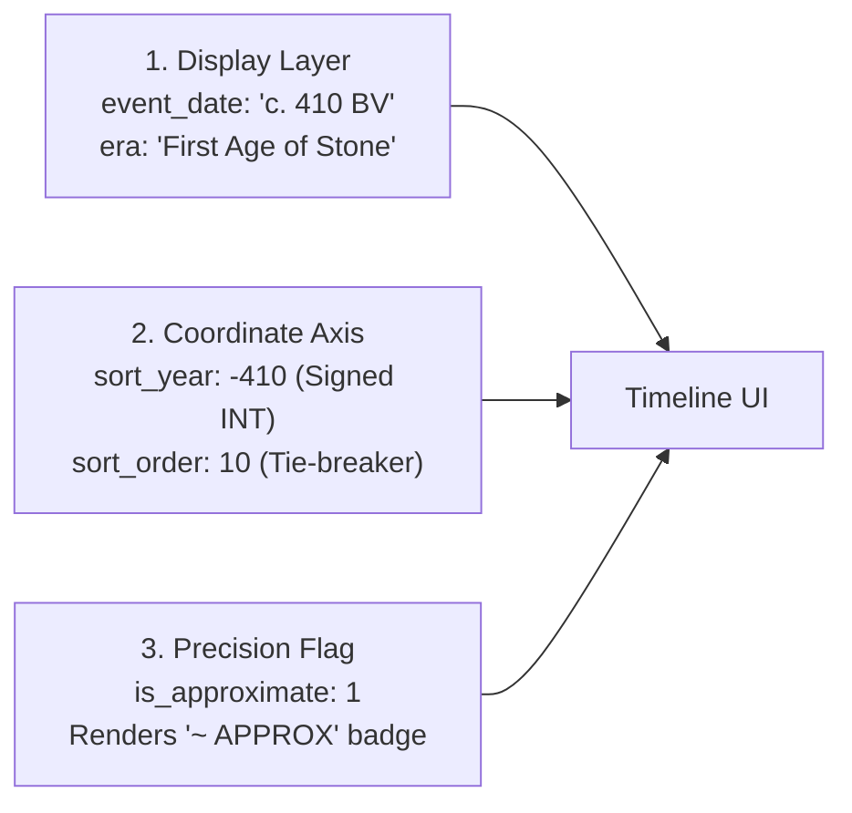

# ✦ LOREKEEPER
### *The Field Archivist's Grimoire & Worldbuilding Workspace*

> A local-first, relational worldbuilding encyclopedia and creative writing environment built with **CodeIgniter 3**, **PHP**, **MySQL**, and **Tailwind CSS**. Designed around tactile dark vellum, antique gold typography, architectural dossiers, and mechanical ink shadows.

---

## ◈ Table of Contents
1. [Overview & Philosophy](#-overview--philosophy)
2. [Tech Stack & Prerequisites](#-tech-stack--prerequisites)
3. [Installation & Setup](#-installation--setup)
4. [Database & Migration System](#-database--migration-system)
5. [Feature Guide & How to Use Lorekeeper](#-feature-guide--how-to-use-lorekeeper)
   - [1. The World Atlas & Frontispiece (Landing Page)](#1-the-world-atlas--frontispiece)
   - [2. The Encyclopedia Registry (Browser & Filters)](#2-the-encyclopedia-registry)
   - [3. Inscribing & Editing Records](#3-inscribing--editing-records)
   - [4. Markdown Scribe Engine & `[[Wiki Links]]`](#4-markdown-scribe-engine--wiki-links)
   - [5. Automatic Bidirectional Backlinks](#5-automatic-bidirectional-backlinks)
   - [6. Reversible Soft-Archiving (Sealing Records)](#6-reversible-soft-archiving)
   - [7. The 3-Layer Fictional Calendar System](#7-the-3-layer-fictional-calendar-system)
6. [Directory Structure](#-directory-structure)
7. [Roadmap](#-roadmap)

---

## 📜 Overview & Philosophy

**Lorekeeper** is built for authors, game masters, and worldbuilders who need more structure than a flat folder of markdown files, but more creative freedom and immersion than a sterile database form.

- **Local-First Sovereign Storage**: Your lore lives entirely in your local MySQL database and disk storage. No cloud vendor lock-in.
- **Relational Integrity with Custom Fields**: Clean SQL tables for worlds, characters, kingdoms, and timelines, with flexible custom properties (`property_definitions` & `property_values`) so you don't alter database schemas when creating new attributes.
- **Grimoire Visual Identity**: Dark charcoal vellum (`#151419`), antique gold leaf (`#C5A869`), copper accents (`#BA7A55`), mechanical 0-blur ink shadows (`#08070A`), architectural `.corner-brackets`, and crimson wax seals.

---

## ⚙ Tech Stack & Prerequisites

- **Environment**: [XAMPP](https://www.apachefriends.org/), WampServer, or native Apache + PHP + MySQL on Windows/macOS/Linux.
- **PHP**: Version `7.4` to `8.2+` (with `mysqli`, `session`, `mbstring`, and `json` extensions).
- **Database**: MySQL `5.7+` or MariaDB `10.3+` (InnoDB engine, `utf8mb4_unicode_ci`).
- **Framework**: CodeIgniter `3.1.13` (lightweight MVC, zero heavy node dependencies required).
- **Front-End Styling**: Tailwind CSS (CDN loaded with custom grimoire color tokens and Google Fonts: *Cormorant Garamond*, *Newsreader*, *Cinzel*, and *Space Mono*).

---

## 🚀 Installation & Setup

### 1. Place Project in Web Root
If using XAMPP on Windows, clone or copy the repository into:
```text
C:\xampp\htdocs\Lorekeeper\
```

### 2. Configure Apache & Base URL
Ensure `mod_rewrite` is enabled in Apache.
The `.htaccess` file in the root is pre-configured to remove `index.php` from URLs:
```apache
RewriteEngine On
RewriteCond %{REQUEST_FILENAME} !-f
RewriteCond %{REQUEST_FILENAME} !-d
RewriteRule ^(.*)$ index.php/$1 [L]
```

Verify your CodeIgniter base URL in `application/config/config.php`:
```php
$config['base_url'] = 'http://localhost/Lorekeeper/';
$config['index_page'] = '';
```

### 3. Database Credentials
Ensure MySQL is running in XAMPP (Port `3306`).
Check `application/config/database.php` (default local configuration):
```php
'hostname' => 'localhost',
'username' => 'root',
'password' => '',
'database' => 'lorekeeper',
'char_set' => 'utf8mb4',
'dbcollat' => 'utf8mb4_unicode_ci',
```

---

## 🗄 Database & Migration System

Lorekeeper uses a sequential CodeIgniter migration runner. All migrations are located in `application/migrations/`:

| Migration | Purpose |
| :--- | :--- |
| `001_create_worlds.php` | Fictional universes (`id`, `public_id` UUID, `name`, `slug`, `description`) |
| `002_create_entry_types.php` | Templates (*Persons & Clans*, *Realms*, *Orders*, *Bestiary*, *Chronicle*) |
| `003_create_entries.php` | Canonical articles, Markdown bodies, and status flags |
| `004_create_properties.php` | Dynamic typed custom fields (`definitions` & `values`) |
| `005_create_relationships.php` | Directed graph relationships (*member_of*, *allied_with*, etc.) |
| `006_create_tags.php` | Reusable folklore tags and junction table (`entry_tags`) |
| `007_create_timeline.php` | Chronological events with fictional calendar coordinates |
| `008_create_media.php` | Uploaded local artwork, maps, and portrait attachments |
| `009_create_users_and_members.php` | Multi-user support, world membership roles, and audit columns |
| `010_align_chatgpt_and_calendar.php` | 3-Layer fictional calendar fields, soft-delete, and `UNIQUE` constraints |

### Running Migrations

#### Option A: Via Browser
Navigate to:
```text
http://localhost/Lorekeeper/migrate
```
The runner will automatically create the `lorekeeper` database if it doesn't exist, apply all sequential migrations up to version 10, and report a success card.

#### Option B: Via Command Line (CLI)
From the project root:
```bash
C:\xampp\php\php.exe index.php migrate
```

*Note: The first time you visit the application, it automatically seeds an initial administrator user (`Scribe Weng`), the initial world (**Canaan**), the 5 entry types, and 5 rich starter records.*

---

## 📖 Feature Guide & How to Use Lorekeeper

### 1. The World Atlas & Frontispiece
**URL**: `http://localhost/Lorekeeper/`

The landing page acts as the **Imperial Reading Frontispiece** of your active world (*Canaan*):
- **Hero Artwork Panorama**: Wide framed artwork plate (`PLATE I`) with celestial astrolabe geometry, active world epigraph, and a quick-finder search bar.
- **The Five Archive Tomes**: Standing leather-bound books (`TOMUS I` to `TOMUS V`) representing *Persons & Clans*, *Realms & Seats*, *Sacred Orders*, *Bestiary & Relics*, and *Chronicle & Eras*. Displays live record counts and opens the filtered registry in one click.
- **World Compendium Spread**: A two-column editorial spread introducing the mythos, history, and geography of the realm, alongside framed cartography (`PLATE II`) and architectural engraving (`PLATE III`) placeholders.
- **Lore Spotlight Card**: Dynamic character dossier with a **`[↻ RANDOM RECORD]`** button to draw inspiration from the archives.
- **The Chronological Tapestry**: A live horizontal timeline ribbon displaying historical milestones ordered along the fictional calendar axis.

---

### 2. The Encyclopedia Registry
**URL**: `http://localhost/Lorekeeper/entries`

The master catalog for searching and filtering all records in the active world:
- **Full-Text Search (`?q=`)**: Searches across titles, summaries, and full markdown article bodies.
- **Category Filter (`?type=`)**: Filter by *Persons*, *Realms*, *Orders*, *Bestiary*, or *Chronicle*.
- **Status Filter (`?status=`)**: Filter by `canon`, `draft`, `apocrypha`, `retconned`, or `archived`.
- **Folklore Tag Cloud (`?tag=`)**: One-click filtering by tags (e.g. `#northmen`, `#draugar`).
- **Dual-Mode Display Switcher**: Toggle between:
  - **Dossier Cards View**: Architectural character/codex cards with `.corner-brackets`, status stamps, and attribute telemetry.
  - **Registry Table View**: Dense ledger rows for rapid archive scanning.
  - *Preference is automatically remembered via browser `localStorage`.*

---

### 3. Inscribing & Editing Records
- **Inscribe New Record**: `http://localhost/Lorekeeper/entries/create`
- **Edit Existing Record**: `http://localhost/Lorekeeper/entries/edit/{id}`

#### Scribe Form Fields:
1. **Entry Type (Template)**: Select *Persons & Clans*, *Realms & Seats*, etc. Changing this dropdown dynamically swaps the visible **Structured Attributes** inputs without reloading the page.
2. **Title**: Name of the person, citadel, faction, or relic.
3. **Slug**: Web-safe URL identifier (auto-generated from title or custom).
4. **Canon Status**:
   - `CANON`: Official lore verified in the world canon.
   - `DRAFT`: Manuscript in progress.
   - `APOCRYPHA`: Conflicting myth, folk tale, or unverified rumor.
   - `RETCONNED`: Deprecated historical record kept for reference.
5. **Portrait / Cover Art**: Filename of the associated image or plate in `storage/media/` (e.g. `ILSABET_VOSS_PORTRAIT.WEBP`).
6. **Structured Attributes**: Dynamic fields defined for that category (e.g., *Origin Seat*, *Cohort / Clan*, *Arcane Aspect*, *Primary Relic*).
7. **Categorical Tags**: Comma-separated tags (e.g. `northmen, lamplighter, iron-pass`).
8. **Summary / Synopsis**: 1–2 sentence excerpt displayed on cards and search results.
9. **Full Article Body (Markdown)**: The canonical lore text (supports full Markdown and `[[Wiki Links]]`).

---

### 4. Markdown Scribe Engine & `[[Wiki Links]]`

Lorekeeper includes a custom parser engine ([`Markdown_parser.php`](file:///c:/xampp/htdocs/Lorekeeper/application/libraries/Markdown_parser.php)) tailored for worldbuilding typography.

#### Supported Markdown Syntax:
| Syntax | Renders As |
| :--- | :--- |
| `## Section Title` | Ancient gold display header with horizontal border |
| `### Subsection Title` | Secondary parchment header with diamond marker |
| `> Quoted speech or scripture` | Illuminated blockquote with 4px gold left border and italic prose |
| `**Bold text**` | Bold parchment text with gold accent |
| `*Italic text*` | Italicized classical prose |
| `- List item` | Bullet list with mechanical diamond bullet markers (`◈`) |
| `1. Numbered item` | Numbered ledger list with bracketed numerals (`[01]`) |
| `---` | Decorative grimoire rule with central gold crosshair diamond |
| `` `inline code` `` | Framed telemetry badge with antique gold monospace text |
| ```` ```code block``` ```` | Dark obsidian terminal panel with mechanical ink drop shadow |

#### In-Universe `[[Wiki Link]]` Cross-Referencing:
Cross-reference other records simply by wrapping their names in double brackets:

```markdown
Ilsabet Voss traveled to [[The Frost Keep]] bearing the [[Censer of the North]].
```

1. **Exact Matches (`✦ Link`)**:
   - If *The Frost Keep* exists in the active world, it automatically renders as a gold link:
     `✦ The Frost Keep` &rarr; links to `/entries/view/3`.
2. **Custom Aliases (`[[Target|Display Label]]`)**:
   - Use a pipe (`|`) to display different phrasing in prose:
     ```markdown
     She was scrutinized by [[Order of the Silver Hand|The Silver Synod]].
     ```
     Renders as `✦ The Silver Synod` while linking to `/entries/view/4`.
3. **Unwritten Lore / Redlinks (`✧ Concept [＋]`)**:
   - If you mention a person or kingdom that does not exist in the database yet:
     ```markdown
     She is sworn kin to [[The Draugar King]].
     ```
     Renders as a dashed copper badge: `✧ The Draugar King [＋]`.
   - **One-Click Lore Inscription**: Clicking the `[＋]` badge immediately opens `/entries/create?title=The+Draugar+King` with the title pre-filled so you can inscribe the concept immediately!

#### Interactive Toolbar & Live Preview:
Above the markdown editor in both `create.php` and `edit.php`:
- Clickable toolbar buttons: `[## H2]`, `[### H3]`, `[**B**]`, `[*I*]`, `[> Quote]`, `[• List]`, and `[✦ [[Wiki Link]]]`.
- **`[✎ WRITE]` vs `[👁 PREVIEW]` Tabs**: Click `[👁 PREVIEW]` at any time to render live grimoire typography and test resolved wiki links before saving.

---

### 5. Automatic Bidirectional Backlinks

Whenever an entry mentions another record using `[[Wiki Links]]`, Lorekeeper automatically establishes a **bidirectional backlink**.

When viewing any record (e.g. [`The Frost Keep`](file:///c:/xampp/htdocs/Lorekeeper/application/views/entries/view.php)), a dedicated **Referenced In Other Chronicles (Backlinks)** section appears at the bottom of the dossier:
- Shows every other record that references it (*Ilsabet Voss*, *Kaelen Ward*).
- Displays the surrounding quote snippet with context highlighting.
- Provides a direct one-click link back to the referring article.

---

### 6. Reversible Soft-Archiving

To archive an entry without breaking links or deleting historical records:
1. Open the record in the editor (`/entries/edit/{id}`) or click `[SEAL / ARCHIVE]` on its dossier card.
2. In the **Archival Control** panel, click **`⚠ SEAL / ARCHIVE RECORD`**.
3. **What happens**:
   - The record sets `is_archived = 1` and records a `deleted_at` timestamp.
   - It is hidden from the active registry, search results, and public timeline.
   - All existing `[[Wiki Links]]` to it remain intact, styled with an `[ARCHIVED]` marker.
   - Backlinks and relationships are preserved.
4. **Restoring**:
   - Browse to `/entries?status=archived` to find sealed records.
   - Open the dossier to see a warning banner with a **`✦ UNSEAL & RESTORE RECORD`** button to return it to the active codex at any time.

---

### 7. The 3-Layer Fictional Calendar System

Real-world Gregorian dates (`YYYY-MM-DD`) cannot represent worldbuilding calendars with custom eras (*Before the Veil*, *Second Age*), non-standard months (*"14th of Frostfall"*), approximate dates (*"c. 200 AV"*), or multi-year wars.

Lorekeeper splits fictional dates into **three synchronized layers** in `timeline_events`:



1. **Display Layer (`event_date` & `era`)**: Preserves the in-universe phrasing as written in lore (e.g. `"c. 410 BV"`, `"Solstice, 842 2A"`).
2. **Numeric Chronology Axis (`sort_year` & `end_year`)**:
   - Stored as signed integers (`-410`, `200`, `842`) to enable exact chronological SQL sorting and timeline math across BCE/CE epochs.
   - `end_year` is optional for multi-year reigns, wars, or eras (e.g. `sort_year = -410, end_year = -395`).
3. **Precision Flag (`is_approximate`)**: A boolean flag that displays an `~ APPROX` badge on uncertain or mythic historical records.

---

## 📁 Directory Structure

```text
Lorekeeper/
├── .htaccess                       # Clean URL routing without index.php
├── README.md                       # Master documentation & manual
├── index.php                       # CodeIgniter front controller
├── storage/
│   └── media/                      # Local uploaded portraits, maps & relics
├── application/
│   ├── config/
│   │   ├── autoload.php            # Auto-loaded libraries and helpers
│   │   ├── config.php              # Base URL and session configuration
│   │   ├── database.php            # MySQL connection credentials
│   │   ├── migration.php           # Sequential migration configuration
│   │   └── routes.php              # Application route mappings
│   ├── controllers/
│   │   ├── Dashboard.php           # World Atlas & Reading Frontispiece
│   │   ├── Entries.php             # Registry, CRUD, Archive, and Preview
│   │   └── Migrate.php             # Web-based migration executor
│   ├── libraries/
│   │   └── Markdown_parser.php     # Grimoire Markdown Engine & Wiki Link resolver
│   ├── migrations/
│   │   ├── 001_create_worlds.php
│   │   ├── ...
│   │   ├── 009_create_users_and_members.php
│   │   └── 010_align_chatgpt_and_calendar.php
│   └── views/
│       ├── layouts/
│       │   └── main.php            # Master Grimoire HTML skeleton
│       ├── partials/
│       │   ├── head.php            # Tailwind tokens, fonts, and custom CSS
│       │   ├── topbar.php          # World badge, search shortcut, and user status
│       │   ├── header.php          # Category navigation tabs
│       │   └── footer.php          # Archival status and migration link
│       ├── dashboard/
│       │   └── index.php           # 5-Section World Atlas Frontispiece
│       └── entries/
│           ├── index.php           # Encyclopedia Registry (Cards vs Table)
│           ├── create.php          # Inscribe record form with Scribe toolbar
│           ├── edit.php            # Revision Folio with Archival control
│           └── view.php            # Illuminated Dossier & Backlinks
```

---

## 🗺 Roadmap & Next Steps

- [x] **Phase 1: Foundation & Navigation**
  - [x] CodeIgniter 3 installation & database configuration
  - [x] 10 sequential database migrations with InnoDB foreign keys
  - [x] World Atlas & Reading Frontispiece (`Dashboard`)
  - [x] Encyclopedia Registry with search, filters, and dual-view switcher (`Entries::index`)
- [x] **Phase 2: Scribe & Relational Engine**
  - [x] Entry editing, updating, and reversible soft-archiving (`Entries::edit`, `archive`, `restore`)
  - [x] Markdown Scribe Engine with grimoire typography (`Markdown_parser`)
  - [x] Automatic `[[Wiki Link]]` resolution with uncreated concept redlinks (`[＋]`)
  - [x] Automatic bidirectional backlinks explorer
  - [x] Interactive formatting toolbar and live preview tab switcher
- [ ] **Phase 3: Deep Relations & Visual Tools**
  - [ ] Directed relationship builder (`entry_relationships` graph with bi-directional ties like *member_of*, *ruler_of*, *allied_with*)
  - [ ] Custom template & attribute builder UI (`entry_types` manager)
  - [ ] Interactive chronological timeline & eras view
  - [ ] Local portrait and map image upload handler (`storage/media/`)
  - [ ] Multi-world switcher and export/import packages (JSON/Markdown)

---

*“What is written in the codex endures against the winter.”* — Scribe Weng, *Chronicles of Canaan*
