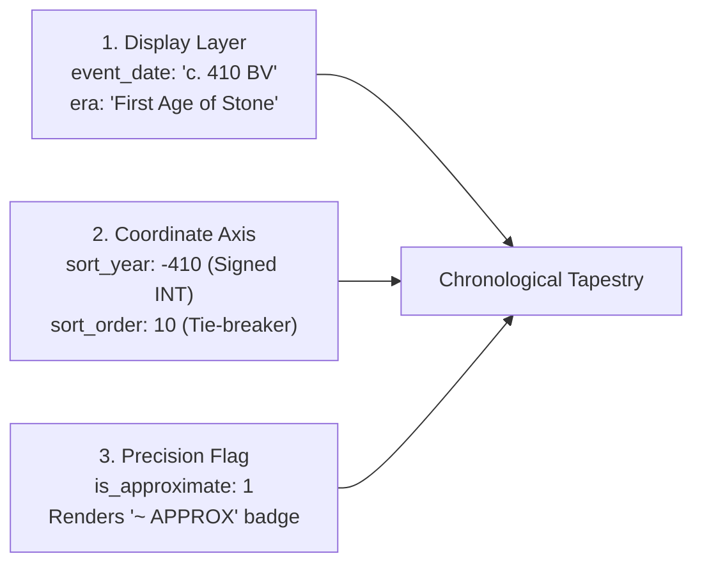

# ✦ LOREKEEPER
### *The Field Archivist's Grimoire & Worldbuilding Workspace*

> A local-first, relational worldbuilding encyclopedia and creative writing environment built with **CodeIgniter 3**, **PHP**, **MySQL**, and **Tailwind CSS**. Designed around tactile dark vellum, antique gold typography, architectural dossiers, and mechanical ink shadows.

---

## ◈ Table of Contents
1. [Overview & Philosophy](#-overview--philosophy)
2. [Tech Stack & Prerequisites](#-tech-stack--prerequisites)
3. [Installation & Setup](#-installation--setup)
4. [Complete Route Directory](#-complete-route-directory)
5. [Database & Migration System](#-database--migration-system)
6. [Core Feature Guide](#-core-feature-guide)
   - [1. The Imperial World Atlas & Frontispiece](#1-the-imperial-world-atlas--frontispiece)
   - [2. The Encyclopedia Registry (Browser & Dual Views)](#2-the-encyclopedia-registry-browser--dual-views)
   - [3. Inscribing & Editing Records (Scribe Engine)](#3-inscribing--editing-records-scribe-engine)
   - [4. Grimoire Markdown Parser & `[[Wiki Links]]`](#4-grimoire-markdown-parser--wiki-links)
   - [5. Media Vault & Visual Systems](#5-media-vault--visual-systems)
     - [Cover Portraits & Fallbacks](#dossier-cover-portraits)
     - [Editor Image Inscriber (Drag-and-Drop & Paste)](#editor-image-inscriber-drag-and-drop--paste)
     - [Illuminated `<figure>` Plates](#illuminated-figure-plates)
     - [Concept Art Folio & Supporting Gallery Drawer](#concept-art-folio--supporting-gallery-drawer)
     - [Global Lightbox Inspection Modal](#global-lightbox-modal)
     - [World Atlas Cartography Plates & Etchings](#world-atlas-cartography-plates--etchings)
   - [6. Directed Relationships Matrix](#6-directed-relationships-matrix)
   - [7. Automatic Bidirectional Backlinks](#7-automatic-bidirectional-backlinks)
   - [8. Reversible Soft-Archiving (Sealing Records)](#8-reversible-soft-archiving-sealing-records)
   - [9. The 3-Layer Fictional Calendar System](#9-the-3-layer-fictional-calendar-system)
   - [10. The Seed Vault & Multi-Genre Blueprints](#10-the-seed-vault--multi-genre-blueprints)
7. [Directory Structure](#-directory-structure)
8. [Roadmap & Milestones](#-roadmap--milestones)

---

## 📜 Overview & Philosophy

**Lorekeeper** is engineered for fantasy authors, tabletop game masters, sci-fi novelists, and worldbuilders who need more structure than a flat folder of markdown files, but more tactile immersion and creative freedom than a sterile spreadsheet.

- **Local-First Sovereign Storage**: Your lore lives entirely in your local MySQL database and disk storage (`storage/media/`). Zero cloud vendor lock-in, zero external subscription dependencies.
- **Relational Integrity with Custom Fields**: Clean SQL tables for worlds, characters, kingdoms, and timelines, with flexible custom properties (`property_definitions` & `property_values`) allowing infinite custom attributes per archetype without altering database schemas.
- **Field Archivist Grimoire Aesthetic**: Dark charcoal vellum (`#151419`), antique gold leaf (`#C5A869`), copper accents (`#BA7A55`), mechanical 0-blur ink drop shadows (`#08070A`), architectural `.corner-brackets`, and crimson wax seals.
- **Hyper-Linked Lore Graph**: Bidirectional backlinks, inline `[[Wiki Links]]`, automatic redlink discovery for unwritten lore concepts, and directed relationship graphs (*ruler_of*, *allied_with*, *wields*, *member_of*).

---

## ⚙ Tech Stack & Prerequisites

- **Environment**: [XAMPP](https://www.apachefriends.org/), WampServer, or native Apache + PHP + MySQL on Windows, macOS, or Linux.
- **PHP**: Version `7.4` to `8.2+` (with `mysqli`, `session`, `mbstring`, `gd`, and `json` extensions).
- **Database**: MySQL `5.7+` or MariaDB `10.3+` (InnoDB engine, `utf8mb4_unicode_ci`).
- **Framework**: CodeIgniter `3.1.13` (lightweight MVC, zero heavy node dependencies required).
- **Front-End Styling**: Tailwind CSS (CDN loaded with custom grimoire color tokens and Google Fonts: *Cormorant Garamond*, *Newsreader*, *Cinzel*, and *Space Mono*).

---

## 🚀 Installation & Setup

### 1. Place Project in Web Root
If using XAMPP on Windows, clone or copy the repository into:
```text
C:\xampp\htdocs\Lorekeeper\
```

### 2. Configure Apache & Base URL
Ensure `mod_rewrite` is enabled in Apache.
The `.htaccess` file in the root is pre-configured to remove `index.php` from URLs:
```apache
RewriteEngine On
RewriteCond %{REQUEST_FILENAME} !-f
RewriteCond %{REQUEST_FILENAME} !-d
RewriteRule ^(.*)$ index.php/$1 [L]
```

Verify your CodeIgniter base URL in [`application/config/config.php`](file:///c:/xampp/htdocs/Lorekeeper/application/config/config.php):
```php
$config['base_url'] = 'http://localhost/Lorekeeper/';
$config['index_page'] = '';
```

### 3. Database Credentials
Ensure MySQL is running in XAMPP (Port `3306`).
Check [`application/config/database.php`](file:///c:/xampp/htdocs/Lorekeeper/application/config/database.php):
```php
'hostname' => 'localhost',
'username' => 'root',
'password' => '',
'database' => 'lorekeeper',
'char_set' => 'utf8mb4',
'dbcollat' => 'utf8mb4_unicode_ci',
```

---

## 🗺 Complete Route Directory

Every URI endpoint in Lorekeeper is documented below, mapped to its controller method and corresponding view file:

| HTTP Method | URI Route | Controller & Method | View File / Template | Description |
| :--- | :--- | :--- | :--- | :--- |
| `GET` | `/` or `/dashboard` | [`Dashboard::index()`](file:///c:/xampp/htdocs/Lorekeeper/application/controllers/Dashboard.php#L13) | [`dashboard/index.php`](file:///c:/xampp/htdocs/Lorekeeper/application/views/dashboard/index.php) | Imperial World Atlas frontispiece, 5 Prime Archive Tomes, Hero Panorama, Map Plate, Architectural Engraving, Lore Spotlight, Chronological Tapestry. |
| `GET` / `POST` | `/dashboard/settings` | [`Dashboard::settings()`](file:///c:/xampp/htdocs/Lorekeeper/application/controllers/Dashboard.php#L202) | [`dashboard/settings.php`](file:///c:/xampp/htdocs/Lorekeeper/application/views/dashboard/settings.php) | World Compendium & Atlas Settings Editor (annals label, narrative pillars 1-3, hero panorama, map plate & landmark nodes 1-3, architectural etching). |
| `GET` | `/entries` | [`Entries::index()`](file:///c:/xampp/htdocs/Lorekeeper/application/controllers/Entries.php#L17) | [`entries/index.php`](file:///c:/xampp/htdocs/Lorekeeper/application/views/entries/index.php) | Master Encyclopedia Registry with full-text search (`?q=`), type filter (`?type=`), status filter (`?status=`), tag filter (`?tag=`), sorting (`?sort=`), and dual-mode switcher (Dossier Cards vs Ledger Table). |
| `GET` | `/entries/create` | [`Entries::create()`](file:///c:/xampp/htdocs/Lorekeeper/application/controllers/Entries.php#L161) | [`entries/create.php`](file:///c:/xampp/htdocs/Lorekeeper/application/views/entries/create.php) | Inscribe New Record form with live attribute swapping, Scribe formatting toolbar, and drag-and-drop & clipboard paste inscriber. |
| `POST` | `/entries/store` | [`Entries::store()`](file:///c:/xampp/htdocs/Lorekeeper/application/controllers/Entries.php#L204) | *N/A (Redirects to view)* | Validates and persists new canonical entry, custom dynamic attributes, and folklore tags. |
| `GET` | `/entries/view/{id}` | [`Entries::view()`](file:///c:/xampp/htdocs/Lorekeeper/application/controllers/Entries.php#L299) | [`entries/view.php`](file:///c:/xampp/htdocs/Lorekeeper/application/views/entries/view.php) | Master Illuminated Dossier with cover portrait, metadata telemetry, illuminated Markdown prose, Roman numeral Plates (`PLATE I`, `PLATE II`), bidirectional backlinks explorer, directed relationships matrix, and Concept Art Folio & Supporting Gallery Drawer. |
| `POST` | `/entries/preview` | [`Entries::preview()`](file:///c:/xampp/htdocs/Lorekeeper/application/controllers/Entries.php#L439) | *N/A (Returns JSON)* | Live AJAX Markdown preview renderer returning parsed HTML with resolved wiki links, redlinks, and illuminated figure plates. |
| `GET` | `/entries/edit/{id}` | [`Entries::edit()`](file:///c:/xampp/htdocs/Lorekeeper/application/controllers/Entries.php#L456) | [`entries/edit.php`](file:///c:/xampp/htdocs/Lorekeeper/application/views/entries/edit.php) | Revision Folio editor with live attribute inputs, Scribe toolbar, drag-and-drop & paste inscriber, and soft-archiving seal/unseal controls. |
| `POST` | `/entries/update/{id}` | [`Entries::update()`](file:///c:/xampp/htdocs/Lorekeeper/application/controllers/Entries.php#L525) | *N/A (Redirects to view)* | Persists modifications to entry prose, metadata, attributes, and tags. |
| `POST` | `/entries/archive/{id}` | [`Entries::archive()`](file:///c:/xampp/htdocs/Lorekeeper/application/controllers/Entries.php#L637) | *N/A (Redirects to edit)* | Reversible soft-archive (seal) a record (`is_archived = 1`, `deleted_at`). |
| `POST` | `/entries/restore/{id}` | [`Entries::restore()`](file:///c:/xampp/htdocs/Lorekeeper/application/controllers/Entries.php#L659) | *N/A (Redirects to edit)* | Unseal and restore a record back to the active codex (`is_archived = 0`). |
| `POST` | `/media/upload` | [`Media::upload()`](file:///c:/xampp/htdocs/Lorekeeper/application/controllers/Media.php#L44) | *N/A (Returns JSON)* | High-speed media inscriber endpoint. Uploads images to `storage/media/` with collision-resistant hashing, records metadata in `media_attachments`, and returns JSON payload with URL, Markdown figure tag, and file metadata. |
| `POST` | `/media/set_cover` | [`Media::set_cover()`](file:///c:/xampp/htdocs/Lorekeeper/application/controllers/Media.php#L187) | *N/A (Returns JSON)* | Designates an uploaded media plate as the primary cover portrait of an entry. |
| `POST` | `/media/remove_cover` | [`Media::remove_cover()`](file:///c:/xampp/htdocs/Lorekeeper/application/controllers/Media.php#L229) | *N/A (Returns JSON)* | Clears the cover portrait from an entry. |
| `GET` | `/media/gallery/{entry_id}` | [`Media::gallery()`](file:///c:/xampp/htdocs/Lorekeeper/application/controllers/Media.php#L248) | *N/A (Returns JSON)* | Fetches all attached media plates for an entry in JSON format. |
| `POST` | `/media/delete/{id}` | [`Media::delete()`](file:///c:/xampp/htdocs/Lorekeeper/application/controllers/Media.php#L273) | *N/A (Returns JSON)* | Severs attachment record from database and safely unlinks physical file from `storage/media/`. |
| `GET` | `/relationships` | [`Relationships::index()`](file:///c:/xampp/htdocs/Lorekeeper/application/controllers/Relationships.php#L17) | [`relationships/index.php`](file:///c:/xampp/htdocs/Lorekeeper/application/views/relationships/index.php) | Graph Relations Matrix showing all forged directed bonds across the active realm. |
| `POST` | `/relationships/store` | [`Relationships::store()`](file:///c:/xampp/htdocs/Lorekeeper/application/controllers/Relationships.php#L116) | *N/A (Redirects to referrer)* | Forges a directed bond between two entries with optional inverse relationship creation. |
| `POST` | `/relationships/delete/{id}` | [`Relationships::delete()`](file:///c:/xampp/htdocs/Lorekeeper/application/controllers/Relationships.php#L209) | *N/A (Redirects to referrer)* | Severs a relationship bond. |
| `GET` | `/seed` | [`Seed::index()`](file:///c:/xampp/htdocs/Lorekeeper/application/controllers/Seed.php#L33) | [`seed/index.php`](file:///c:/xampp/htdocs/Lorekeeper/application/views/seed/index.php) | Seed Vault UI showcasing ready-to-run world starter templates and archetype expansions. |
| `POST` | `/seed/run/{seeder_key}` | [`Seed::run()`](file:///c:/xampp/htdocs/Lorekeeper/application/controllers/Seed.php#L103) | *N/A (Redirects to seed)* | Instantiates and executes a seeder pack, generating worlds, entry types, entries, relationships, timeline events, and sample tags. |
| `GET` | `/worlds/switch_world/{id}` | [`Worlds::switch_world()`](file:///c:/xampp/htdocs/Lorekeeper/application/controllers/Worlds.php#L17) | *N/A (Redirects to referrer)* | Switches active realm in archivist session. |
| `GET` / `POST` | `/worlds/create` | [`Worlds::create()`](file:///c:/xampp/htdocs/Lorekeeper/application/controllers/Worlds.php#L38) | [`worlds/create.php`](file:///c:/xampp/htdocs/Lorekeeper/application/views/worlds/create.php) | Scaffolds a new fictional universe realm. |
| `GET` | `/migrate` | [`Migrate::index()`](file:///c:/xampp/htdocs/Lorekeeper/application/controllers/Migrate.php#L6) | *N/A (Renders card)* | Sequential migration runner (migrations 001 to 010). |

---

## 🗄 Database & Migration System

Lorekeeper uses a sequential CodeIgniter migration runner. All migrations are located in [`application/migrations/`](file:///c:/xampp/htdocs/Lorekeeper/application/migrations/):

| Migration | Purpose | Key Columns & Tables |
| :--- | :--- | :--- |
| [`001_create_worlds.php`](file:///c:/xampp/htdocs/Lorekeeper/application/migrations/001_create_worlds.php) | Fictional universes | `id`, `public_id` (UUID), `name`, `slug`, `description`, `owner_id` |
| [`002_create_entry_types.php`](file:///c:/xampp/htdocs/Lorekeeper/application/migrations/002_create_entry_types.php) | Archetype templates | `id`, `world_id`, `name`, `slug`, `icon`, `color_token`, `sort_order` |
| [`003_create_entries.php`](file:///c:/xampp/htdocs/Lorekeeper/application/migrations/003_create_entries.php) | Canonical articles & prose | `id`, `world_id`, `entry_type_id`, `title`, `slug`, `status`, `summary`, `content_markdown`, `cover_image_path` |
| [`004_create_properties.php`](file:///c:/xampp/htdocs/Lorekeeper/application/migrations/004_create_properties.php) | Custom dynamic attributes | `property_definitions` (`data_type`, `options_json`) & `property_values` (`value_text`, `value_number`, `value_date`) |
| [`005_create_relationships.php`](file:///c:/xampp/htdocs/Lorekeeper/application/migrations/005_create_relationships.php) | Directed graph relationships | `entry_relationships` (`source_entry_id`, `target_entry_id`, `relation_type`, `symmetric_inverse`) |
| [`006_create_tags.php`](file:///c:/xampp/htdocs/Lorekeeper/application/migrations/006_create_tags.php) | Reusable folklore tags | `tags` & `entry_tags` junction table |
| [`007_create_timeline.php`](file:///c:/xampp/htdocs/Lorekeeper/application/migrations/007_create_timeline.php) | Fictional calendar milestones | `timeline_events` (`event_date`, `era`, `sort_year`, `end_year`, `is_approximate`) |
| [`008_create_media.php`](file:///c:/xampp/htdocs/Lorekeeper/application/migrations/008_create_media.php) | Visual media & plates | `media_attachments` (`entry_id`, `world_id`, `original_filename`, `stored_filename`, `file_path`, `mime_type`, `file_size`, `caption`) |
| [`009_create_users_and_members.php`](file:///c:/xampp/htdocs/Lorekeeper/application/migrations/009_create_users_and_members.php) | Multi-user roles & memberships | `users` & `world_members` (`role = 'admin'|'scribe'|'reader'`) |
| [`010_align_chatgpt_and_calendar.php`](file:///c:/xampp/htdocs/Lorekeeper/application/migrations/010_align_chatgpt_and_calendar.php) | Calendar alignment & soft delete | `is_archived`, `deleted_at`, `app_settings` key-value store |

### Running Migrations:
- **Via Browser**: Navigate to `http://localhost/Lorekeeper/migrate`. The runner automatically creates the `lorekeeper` database if missing, executes migrations up to version 10, and renders an illuminated status ledger.
- **Via CLI**:
  ```bash
  C:\xampp\php\php.exe index.php migrate
  ```

---

## 📖 Core Feature Guide

### 1. The Imperial World Atlas & Frontispiece
**URL**: [`http://localhost/Lorekeeper/`](file:///c:/xampp/htdocs/Lorekeeper/) (or `/dashboard`)

The landing page acts as the **Imperial Reading Frontispiece** of your active world:
- **Hero Artwork Panorama (`PLATE I`)**: Wide framed artwork plate featuring celestial astrolabe geometry, active world epigraph, and a quick-finder search bar.
- **The Five Archive Prime Tomes**:
  - `TOMUS I: LIBER PERSONARUM` — Characters, sworn champions, clanwardens, and mythic figures.
  - `TOMUS II: GAZETTEER OF IMPERIA` — Nations, high keeps, basalt citadels, and sovereign seats.
  - `TOMUS III: CODEX RELIQUIARUM` — Artifacts, sanctified censers, ancient runic arms, and talismans.
  - `TOMUS IV: ANNALES AETATUM` — Events, recorded cataclysms, solstice crossings, and covenants.
  - `TOMUS V: COMPENDIUM ARCANUM` — Concepts, cosmic mysteries, primal laws, doctrines, and sacred traditions.
- **Secondary Archive Volumes**: Extended volumes for *Sacred Orders*, *Primordial Species*, *Citadels & Shrines*, and *Occult Arts*.
- **World Compendium Spread**: Two-column editorial spread introducing the mythos, history, and geography of the realm, alongside the framed **Cartographic Survey Map (`PLATE II`)** and **Architectural Engraving (`PLATE III`)**.
- **Lore Spotlight Card**: Dynamic character dossier with a **`[↻ RANDOM RECORD]`** button to draw inspiration from the archives.
- **The Chronological Tapestry**: A live horizontal timeline ribbon displaying historical milestones ordered along the fictional calendar axis.
- **Compendium Settings (`/dashboard/settings`)**: Direct editing form to configure the realm's history paragraphs, narrative pillars 1–3, dominant seat, calendar era, map image plate with 3 custom landmark nodes, and architectural etching.

---

### 2. The Encyclopedia Registry (Browser & Dual Views)
**URL**: [`http://localhost/Lorekeeper/entries`](file:///c:/xampp/htdocs/Lorekeeper/application/views/entries/index.php)

The master catalog for exploring all chronicled entries in the active realm:
- **Full-Text Search (`?q=`)**: Instant query matching against article titles, summaries, and full Markdown prose.
- **Archetype / Category Filter (`?type=`)**: Filter by *Characters*, *Nations*, *Artifacts*, *Events*, *Concepts*, or extended volumes.
- **Status Filter (`?status=`)**: Filter by `canon`, `draft`, `apocrypha`, `retconned`, or `archived`.
- **Folklore Tag Cloud (`?tag=`)**: One-click filtering by folklore tags (e.g. `#northmen`, `#censer`, `#draugar`).
- **Dual-Mode Display Switcher**:
  - **Dossier Cards View**: Architectural codex cards with `.corner-brackets`, status stamps, cover portraits, and attribute telemetry.
  - **Registry Table View**: Dense ledger rows for rapid archive scanning.
  - *Mode preference is automatically persisted across sessions via browser `localStorage`.*

---

### 3. Inscribing & Editing Records (Scribe Engine)
- **Inscribe New Record**: [`http://localhost/Lorekeeper/entries/create`](file:///c:/xampp/htdocs/Lorekeeper/application/views/entries/create.php)
- **Edit Existing Record**: [`http://localhost/Lorekeeper/entries/edit/{id}`](file:///c:/xampp/htdocs/Lorekeeper/application/views/entries/edit.php)

#### Scribe Form Highlights:
1. **Dynamic Attribute Swapping**: Changing the **Entry Type** dropdown automatically swaps visible custom property fields (e.g. *Origin Seat*, *Arcane Aspect*, *Cohort / Clan*, *Primary Relic*) in real-time without reloading the page.
2. **Title & Auto-Slug Generation**: Inscribing a title automatically formats a clean URL-safe slug.
3. **Canon Status Lifecycle**: Designate lore as `CANON`, `DRAFT`, `APOCRYPHA`, or `RETCONNED`.
4. **Primary Cover Portrait**: Select or input a cover filename from `storage/media/` or upload directly.
5. **Categorical Folklore Tags**: Comma-separated tags mapped into the relational tag graph.
6. **Summary / Excerpt**: 1–2 sentence synopsis rendered on dossier cards and search previews.
7. **Interactive Formatting Toolbar**: Quick buttons for `[## H2]`, `[### H3]`, `[**B**]`, `[*I*]`, `[> Quote]`, `[• List]`, `[✦ [[Wiki Link]]]`, and `[🖼 +Plate]`.
8. **Live Dual-Tab Preview Switcher**: Switch between **`[✎ WRITE]`** and **`[👁 PREVIEW]`** tabs to render the live parsed grimoire typography and test wiki links before saving.

---

### 4. Grimoire Markdown Parser & `[[Wiki Links]]`

Lorekeeper's custom parser ([`Markdown_parser.php`](file:///c:/xampp/htdocs/Lorekeeper/application/libraries/Markdown_parser.php)) renders clean prose into antique manuscript typography:

#### Markdown Syntax Reference:
| Syntax | Grimoire Rendering |
| :--- | :--- |
| `## Section Title` | Ancient gold display header with horizontal border rule |
| `### Subsection Title` | Secondary parchment header with diamond marker (`◈`) |
| `> Quoted speech or scripture` | Illuminated blockquote with 4px gold left border and italic prose |
| `**Bold text**` | Bold parchment text with gold accent |
| `*Italic text*` | Italicized classical prose |
| `- List item` | Bullet list with mechanical diamond bullet markers (`◈`) |
| `1. Numbered item` | Numbered ledger list with bracketed numerals (`[01]`) |
| `---` | Decorative grimoire rule with central gold crosshair diamond |
| `` `inline code` `` | Framed telemetry badge with antique gold monospace font |
| ```` ```code block``` ```` | Dark obsidian terminal panel with mechanical ink drop shadow |
| `` | Framed manuscript plate (`PLATE I`, `PLATE II`) with gold corner reticles (`+`) and Lightbox zoom |

#### In-Universe `[[Wiki Link]]` Cross-Referencing:
Cross-reference other records simply by wrapping their names in double brackets:
```markdown
Ilsabet Voss traveled to [[The Frost Keep]] bearing the [[Censer of the North]].
```

1. **Exact Matches (`✦ Link`)**:
   - If *The Frost Keep* exists in the active world, it renders as an antique gold link:
     `✦ The Frost Keep` &rarr; links to `/entries/view/3`.
2. **Custom Aliases (`[[Target|Display Label]]`)**:
   - Use a pipe (`|`) to display different phrasing in prose:
     ```markdown
     She was scrutinized by [[Order of the Silver Hand|The Silver Synod]].
     ```
     Renders as `✦ The Silver Synod` while pointing to `/entries/view/4`.
3. **Unwritten Lore / Redlinks (`✧ Concept [＋]`)**:
   - Mentioning a concept not yet inscribed in the database renders as a dashed copper badge:
     `✧ The Draugar King [＋]`.
   - **One-Click Lore Inscription**: Clicking the `[＋]` badge immediately opens `/entries/create?title=The+Draugar+King` with the title pre-filled.

---

### 5. Media Vault & Visual Systems

The visual media subsystem provides complete image management for dossiers, concept folios, and inline manuscript plates:

#### Dossier Cover Portraits
- Rendered in the master dossier header ([`entries/view.php`](file:///c:/xampp/htdocs/Lorekeeper/application/views/entries/view.php)) with zero-blur mechanical ink drop shadows and corner reticles.
- High-contrast status stamp overlays (`CANON`, `DRAFT`, `APOCRYPHA`).
- If no portrait is assigned, an architectural classical monogram fallback is generated using the entry's initial letter and category badge.

#### Editor Image Inscriber (Drag-and-Drop & Paste)
Implemented in [`partials/editor_inscriber_js.php`](file:///c:/xampp/htdocs/Lorekeeper/application/views/partials/editor_inscriber_js.php) across both `create.php` and `edit.php`:
- **Clipboard Paste Listener (`Ctrl + V`)**: Copy any image or screenshot from your clipboard and paste it directly into the Markdown textarea. The system uploads it asynchronously to `storage/media/` and automatically injects the formatted Markdown plate tag:
  ```markdown
  
  ```
- **Drag-and-Drop Dropzone**: Drag any image file directly over the editor to upload it instantly.
- **Toolbar `[🖼 +Plate]` Uploader**: Dedicated file picker button in the Scribe toolbar.
- **Collision-Resistant Hashing**: Files are automatically stored with collision-resistant naming: `{world_slug}_{entry_slug}_{timestamp}_{hash}.{ext}`.

#### Illuminated `<figure>` Plates
Whenever an image tag `` is processed by [`Markdown_parser.php`](file:///c:/xampp/htdocs/Lorekeeper/application/libraries/Markdown_parser.php):
- Evaluates local storage (`storage/media/`), media attachments metadata, and external URLs.
- Wraps the artwork in an illuminated `<figure>` container with:
  - Antique gold corner reticles (`+`).
  - Roman-numeral sequence stamps (`PLATE I`, `PLATE II`, `PLATE III`).
  - Monospace caption and copper diamond emblem.
  - Hover zoom scaling and `[⤢ ENLARGE]` indicator.

#### Concept Art Folio & Supporting Gallery Drawer
Located at the bottom of every entry dossier ([`entries/view.php`](file:///c:/xampp/htdocs/Lorekeeper/application/views/entries/view.php)):
- Displays a grid of all concept art, cartographic surveys, and relics attached to the record.
- **Quick Actions on Each Plate**:
  - **`[★ Set Cover]`**: Promotes the plate to the primary dossier portrait via AJAX `/media/set_cover`.
  - **`[📋 Copy Tag]`**: Copies the ready-to-paste `` tag into your clipboard.
  - **`[✕ Delete]`**: Safely severs the attachment and unlinks the physical file via `/media/delete/{id}`.
  - **`[⤢ Enlarge]`**: Opens the high-resolution artwork in the lightbox modal.
- **Drag-and-Drop Folio Uploader**: Dropzone inside the folio drawer allowing archivist to attach multiple pieces of concept art without opening the editor.
- **Sidebar Quick Anchor**: Sticky navigation button `[ ✦ FOLIO ATTACHMENTS (X PLATES ↓) ]` for one-click jumping to the gallery.

#### Global Lightbox Modal
Implemented in [`partials/lightbox.php`](file:///c:/xampp/htdocs/Lorekeeper/application/views/partials/lightbox.php) and loaded via [`partials/footer.php`](file:///c:/xampp/htdocs/Lorekeeper/application/views/partials/footer.php):
- Accessible across the entire application (Frontispiece Atlas, Dossiers, Folio Drawer, and Markdown Plates).
- Smooth zoom inspection with antique gold title caption and `Esc` key dismiss listener.

#### World Atlas Cartography Plates & Etchings
Configured in [`dashboard/settings.php`](file:///c:/xampp/htdocs/Lorekeeper/application/views/dashboard/settings.php) and displayed on [`dashboard/index.php`](file:///c:/xampp/htdocs/Lorekeeper/application/views/dashboard/index.php):
- **Hero Artwork Panorama (`PLATE I`)**: Upload custom panoramic artwork for the realm frontispiece.
- **Cartographic Survey Map (`PLATE II`)**: Upload custom world or regional map plates with 3 configurable landmark pin nodes (*High Seat of Frost*, *Iron Pass Bastion*, *Sunken Spires*).
- **Architectural Engraving (`PLATE III`)**: Upload high-contrast architectural drawings or relic engravings.

---

### 6. Directed Relationships Matrix
**URL**: [`http://localhost/Lorekeeper/relationships`](file:///c:/xampp/htdocs/Lorekeeper/application/views/relationships/index.php)

The directed relationship system connects entries into a cohesive lore graph:
- **Forge New Bonds**: Select source entry, target entry, relationship type, and optional custom notes.
- **Relationship Types Supported**:
  - `member_of` / `cohort_of` (Persons &rarr; Orders/Realms)
  - `ruler_of` / `ruled_by` (Persons &rarr; Kingdoms)
  - `allied_with` / `rival_of` (Realms &rarr; Realms, Clans &rarr; Clans)
  - `wields` / `wielded_by` (Persons &rarr; Artifacts)
  - `located_in` / `contains` (Seats &rarr; Realms)
  - `parent_of` / `child_of` (Genealogical ties)
  - `sworn_to` (Fealty covenants)
  - `created` / `destroyed` (Events &rarr; Relics/Citadels)
- **Bidirectional Inverses**: Toggle the "Forge Symmetric Inverse" checkbox to automatically create the reverse bond in the target's dossier.
- **In-Dossier Graph Ledger**: Every entry's dossier displays its active relationships divided into outward bonds and incoming ties.

---

### 7. Automatic Bidirectional Backlinks

Whenever any record mentions another article using `[[Wiki Links]]`, Lorekeeper automatically establishes an indexed **bidirectional backlink**.

When viewing any entry (e.g. [`The Frost Keep`](file:///c:/xampp/htdocs/Lorekeeper/application/views/entries/view.php)):
- A dedicated **Referenced In Other Chronicles (Backlinks)** drawer appears at the bottom of the dossier.
- Lists every referring record (*Ilsabet Voss*, *Kaelen Ward*, *The First Covenant*).
- Extracts and highlights the contextual quote snippet surrounding the mention.
- Provides a direct link back to the referring article.

---

### 8. Reversible Soft-Archiving (Sealing Records)

To archive deprecated or superseded lore without breaking historical references or foreign keys:
1. Open the record in the editor ([`/entries/edit/{id}`](file:///c:/xampp/htdocs/Lorekeeper/application/views/entries/edit.php)) or click `[SEAL / ARCHIVE]` on its dossier card.
2. In the **Archival Control** panel, click **`⚠ SEAL / ARCHIVE RECORD`**.
3. **What happens**:
   - Sets `is_archived = 1` and records the `deleted_at` timestamp.
   - Hides the record from default registry listings, global search, and public timeline feeds.
   - All existing `[[Wiki Links]]` to it remain intact, clearly annotated with an `[ARCHIVED]` marker.
   - Backlinks and relationships graph ties are fully preserved.
4. **Restoring**:
   - Filter by status `?status=archived` in the registry.
   - Click **`✦ UNSEAL & RESTORE RECORD`** in the revision folio to restore it immediately.

---

### 9. The 3-Layer Fictional Calendar System

Real-world Gregorian dates cannot handle fantasy or sci-fi calendars with custom eras (*Before the Veil*, *Second Age*), non-standard month names (*"14th of Frostfall"*), approximate dates (*"c. 200 AV"*), or multi-year reigns and wars.

Lorekeeper splits dates into **three synchronized layers** in `timeline_events`:



1. **Display Layer (`event_date` & `era`)**: Preserves the in-universe phrasing as written in lore (e.g. `"c. 410 BV"`, `"Solstice, 842 2A"`).
2. **Numeric Chronology Axis (`sort_year` & `end_year`)**: Stored as signed integers (`-410`, `842`) to enable exact SQL sorting and timeline math across BCE/CE epochs. Optional `end_year` supports spans like wars or reigns.
3. **Precision Flag (`is_approximate`)**: A boolean flag displaying an `~ APPROX` badge on mythic or uncertain historical milestones.

---

### 10. The Seed Vault & Multi-Genre Blueprints
**URL**: [`http://localhost/Lorekeeper/seed`](file:///c:/xampp/htdocs/Lorekeeper/application/views/seed/index.php)

The Seed Vault allows worldbuilders to populate complete, rich universes with one click or use templates to craft their own:

- **Available Seeder Packs**:
  1. **Canaan: Saga I (Grand Dark Fantasy)**: Complete universe of 30+ interconnected canonical entries across all 9 archetype volumes (*Persons*, *Nations*, *Artifacts*, *Events*, *Concepts*, *Orders*, *Species*, *Locations*, *Magic*), rich Markdown prose, relationships graph, and timeline events.
  2. **Canaan: 9-Archetype Expansion**: Expands an existing baseline Canaan world with secondary archetypes and structured properties.
  3. **Cyberpunk: Neo-Kyoto 2099**: Gritty high-tech / low-life universe featuring megacorporations, cybernetic mercenaries, black-market neural implants, and corporate wars.
  4. **Aethelgard: Sunken Archipelago**: Nautical eldritch fantasy world of coral citadels, leviathan cults, tidal astrolabes, and drowned gods.
  5. **World Seeder Blueprint Template** ([`application/seeds/World_seeder_template.php`](file:///c:/xampp/htdocs/Lorekeeper/application/seeds/World_seeder_template.php)): Reusable PHP boilerplate class for authors writing their own modular lore expansions.
- **One-Click Instantiation**: Preview entry counts, relationships, and timeline distributions, and run seeders directly via the web UI.

---

## 📁 Directory Structure

```text
Lorekeeper/
├── .htaccess                               # Clean URL routing without index.php
├── README.md                               # Master documentation & manual
├── PROJECT_PLAN.md                         # Milestone tracking & architecture specs
├── index.php                               # CodeIgniter front controller
├── storage/
│   └── media/                              # Uploaded portraits, concept art & maps
├── application/
│   ├── config/
│   │   ├── autoload.php                    # Auto-loaded libraries and helpers
│   │   ├── config.php                      # Base URL and session configuration
│   │   ├── database.php                    # MySQL connection credentials
│   │   ├── migration.php                   # Sequential migration configuration
│   │   └── routes.php                      # Application route mappings
│   ├── controllers/
│   │   ├── Dashboard.php                   # World Atlas Frontispiece & Settings
│   │   ├── Entries.php                     # Registry, CRUD, Archive, and Live Preview
│   │   ├── Media.php                       # Uploads, Cover Art, Folio Drawer, Deletions
│   │   ├── Migrate.php                     # Web migration runner
│   │   ├── Relationships.php               # Graph relations matrix & bond forging
│   │   ├── Seed.php                        # Seed Vault blueprint catalog & runner
│   │   └── Worlds.php                      # Realm switcher and world creation
│   ├── libraries/
│   │   └── Markdown_parser.php             # Grimoire Markdown, Wiki Links & Plates
│   ├── migrations/
│   │   ├── 001_create_worlds.php
│   │   ├── 002_create_entry_types.php
│   │   ├── 003_create_entries.php
│   │   ├── 004_create_properties.php
│   │   ├── 005_create_relationships.php
│   │   ├── 006_create_tags.php
│   │   ├── 007_create_timeline.php
│   │   ├── 008_create_media.php
│   │   ├── 009_create_users_and_members.php
│   │   └── 010_align_chatgpt_and_calendar.php
│   ├── seeds/
│   │   ├── Canaan_saga1_seeder.php         # Grand Dark Fantasy seed pack (30+ entries)
│   │   ├── Canaan_expansion_seeder.php     # 9-Archetype secondary volume expansion
│   │   ├── Cyberpunk_seeder.php            # Neo-Kyoto 2099 sci-fi seed pack
│   │   ├── Aethelgard_seeder.php           # Sunken Archipelago seafaring seed pack
│   │   └── World_seeder_template.php       # Boilerplate blueprint for new worlds
│   └── views/
│       ├── layouts/
│       │   └── main.php                    # Master Grimoire HTML skeleton
│       ├── partials/
│       │   ├── head.php                    # Tailwind tokens, fonts, and custom CSS
│       │   ├── topbar.php                  # World badge, search shortcut, and user status
│       │   ├── header.php                  # Category navigation tabs
│       │   ├── editor_inscriber_js.php     # Drag-and-drop & clipboard paste inscriber
│       │   ├── lightbox.php                # Global artwork lightbox zoom modal
│       │   └── footer.php                  # Archival status and migration links
│       ├── dashboard/
│       │   ├── index.php                   # 5-Section World Atlas Frontispiece
│       │   └── settings.php                # Compendium & Cartography settings form
│       ├── entries/
│       │   ├── index.php                   # Encyclopedia Registry (Cards vs Table)
│       │   ├── create.php                  # Inscribe record form with Scribe toolbar
│       │   ├── edit.php                    # Revision Folio with Archival control
│       │   └── view.php                    # Illuminated Dossier, Backlinks & Folio Drawer
│       ├── relationships/
│       │   └── index.php                   # Directed Relations Matrix Explorer
│       ├── seed/
│       │   └── index.php                   # Seed Vault Blueprint Catalog
│       └── worlds/
│           └── create.php                  # Scaffold New Realm Form
```

---

## 🗺 Roadmap & Milestones

- [x] **Milestone 1: Foundation, Relational Architecture & Navigation (100%)**
  - [x] CodeIgniter 3 installation & database configuration
  - [x] 10 sequential database migrations with InnoDB foreign keys
  - [x] Imperial World Atlas & Reading Frontispiece (`Dashboard`)
  - [x] 5 Prime Archive Tomes (`TOMUS I` to `TOMUS V`) + 4 Extended Secondary Volumes
  - [x] Encyclopedia Registry with search, filters, and dual-mode switcher (`Entries::index`)
- [x] **Milestone 2: Scribe Engine, Wiki Links & Backlinks (100%)**
  - [x] Reversible soft-archiving with seal & unseal controls (`is_archived = 1`)
  - [x] Markdown Scribe Engine with grimoire typography (`Markdown_parser`)
  - [x] Automatic `[[Wiki Link]]` resolution with uncreated concept redlinks (`[＋]`)
  - [x] Automatic bidirectional backlinks explorer with highlighted quote snippets
  - [x] Scribe formatting toolbar with live AJAX preview switcher (`[✎ WRITE]` vs `[👁 PREVIEW]`)
- [x] **Milestone 3: Seed Vault & Multi-Genre Blueprints (100%)**
  - [x] Multi-genre Seed Vault UI (`/seed`) with database status check
  - [x] Grand Dark Fantasy *Canaan: Saga I* seeder pack with 30+ interconnected entries
  - [x] Cyberpunk (*Neo-Kyoto 2099*) and Eldritch Nautical (*Sunken Archipelago*) seed packs
  - [x] Reusable PHP seeder template boilerplate (`World_seeder_template.php`)
- [x] **Milestone 4: Media Vault & Visual Systems (100%)**
  - [x] Dossier Cover Portrait system with fallback classical monograms
  - [x] Media upload controller with collision-resistant hashing and physical storage (`storage/media/`)
  - [x] Editor Inscriber with clipboard paste (`Ctrl + V`), drag-and-drop, and toolbar upload
  - [x] Roman-numeral Illuminated `<figure>` Plates (`PLATE I`, `PLATE II`) with gold corner reticles
  - [x] Global Lightbox zoom modal across all plates and artwork
  - [x] World Atlas Cartography Survey Map (`PLATE II`) with interactive landmark nodes
  - [x] Concept Art Folio & Supporting Gallery Drawer with quick actions (`[★ Set Cover]`, `[📋 Copy Tag]`, `[✕ Delete]`, `[⤢ Enlarge]`)
- [ ] **Milestone 5: Advanced Visual Graph & World Export (Planned)**
  - [ ] Interactive 2D/3D force-directed relationship node graph (Canvas / D3 / Vis.js)
  - [ ] Full realm export and import packages (JSON / Markdown archives)
  - [ ] Interactive chronological timeline zoom canvas
  - [ ] Multi-archivist role-based access control (RBAC) permissions

---

*“What is written in the codex endures against the winter.”* — Scribe Weng, *Chronicles of Canaan*
